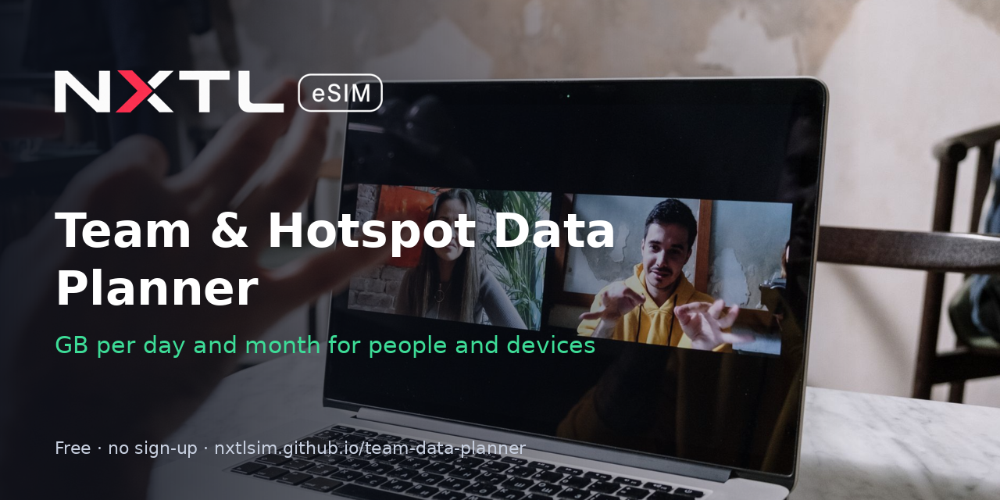

# Team & Hotspot Data Planner

**Live app:** https://nxtlsim.github.io/team-data-planner/

Plan mobile data for a team or a device fleet. Add laptops (remote workers), work phones, backup routers, GPS trackers, cameras or POS terminals, set quantities and days, and get the data needed per day, per 30 days and in total, with a per-item breakdown. Works on phone and desktop and installs as an app (PWA). No sign-up, no trackers, and results are shareable by URL.

## Assumptions (MB per day, per item, editable)
| Preset | MB/day | Basis |
|---|---|---|
| Laptop – remote worker | 1500 | estimate: a workday of email, docs, chat and about an hour of video calls |
| Phone – work use | 300 | estimate |
| Router – backup line (standby) | 200 | estimate for an occasional failover; set the real figure for a primary line |
| GPS tracker | 3 | estimate for frequent position reports |
| Camera – motion clips | 1000 | estimate; continuous streaming uses far more |
| POS terminal | 15 | estimate |

All figures are rough starting points, not measurements. Replace them with your own usage stats.

## Cost line
Shows the cost at the NXTL pay-as-you-go rate for the chosen country, using the Cheapest-network rate, which is the default setting. Rates load live from the public endpoint `https://nxtlsim.com/wp-json/nxtl-app/v1/pricing/countries`. If it can't be reached, the app uses the bundled `docs/rates.json` snapshot (checked 2026-10-26). Each device that connects directly needs its own eSIM, activated on that device. Business accounts: https://nxtlsim.com/for-business/

## Share links
`?i=laptop:3,router:1:500&c=Germany&days=30` (format `preset:qty[:mbPerDay]`)

## Files
`docs/` index.html, manifest.json, sw.js, rates.json, icon-192.png, icon-512.png

MIT licence. Built by [NXTL eSIM](https://nxtlsim.com/?utm_source=github&utm_medium=readme&utm_campaign=team-data-planner). Cover photo: cottonbro studio on Pexels.
